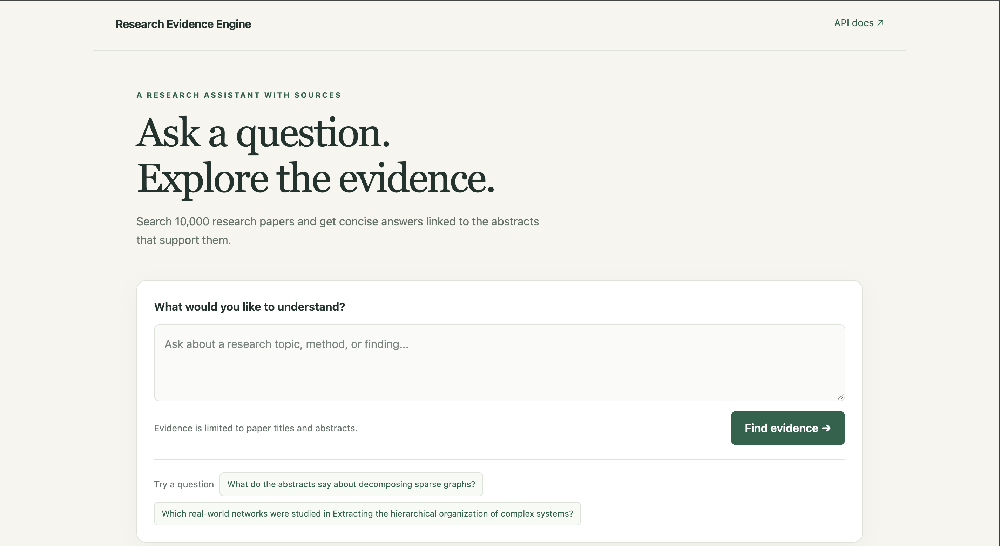
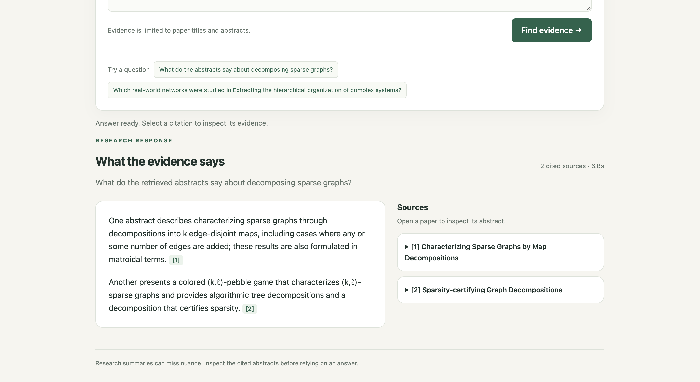
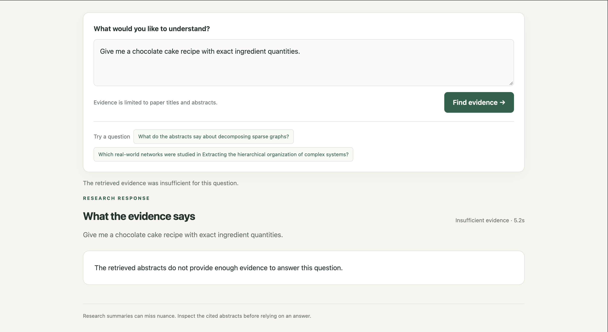
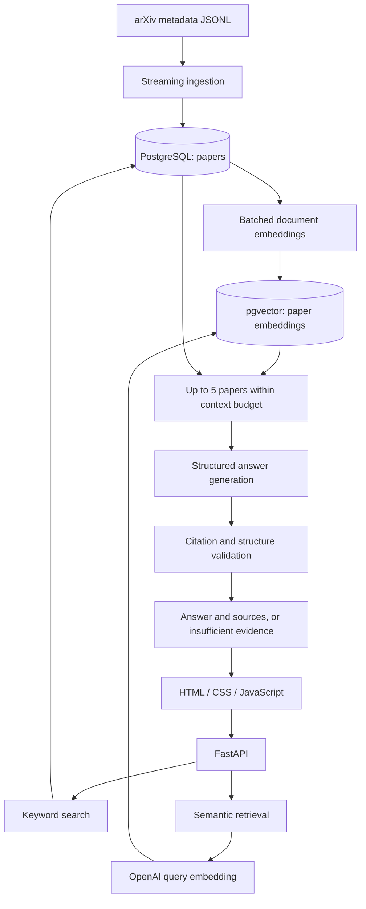

# Research Evidence Engine

An abstract-based research assistant that retrieves evidence from 10,000 arXiv papers and produces concise answers with inspectable citations.

Built with FastAPI, PostgreSQL, pgvector, LangChain, and LangGraph, with a lightweight HTML/CSS/JavaScript interface.

The application answers from paper titles and abstracts. It does not read full papers or browse the web.

## Demo

### Home Page



### Answer with supporting evidence

Each answer includes citations linked to expandable source abstracts and the original arXiv papers.



### Insufficient evidence

When the retrieved abstracts do not support an answer, the application returns an explicit insufficient-evidence response.



## Features

- Stream and ingest 10,000 paper records from an arXiv metadata snapshot.
- Search titles and abstracts using PostgreSQL full-text search.
- Retrieve semantically related papers using OpenAI embeddings and pgvector.
- Generate structured, cited answers through a LangGraph workflow.
- Validate citation IDs against the evidence supplied to the model.
- Display source abstracts alongside generated answers.
- Evaluate retrieval, abstention, and answer support separately.
- Run the application and database locally with Docker Compose.

## Measured results

### Keyword-search performance

Adding a PostgreSQL GIN index reduced the median per-run p95 request latency by **76.66%** on a local 10,000-paper benchmark.

| Configuration | Median per-run p95 | Failed requests |
|---|---:|---:|
| Without full-text index | 742.384 ms | 0/300 |
| With GIN full-text index | 173.274 ms | 0/300 |

Each configuration was measured over three runs of 100 requests, using ten diagnostic queries, a result limit of ten, and one concurrent request. Each run included a warm-up request for every query.

These are keyword-search endpoint measurements, not end-to-end RAG latency or a concurrent-load benchmark.

Query plans confirmed use of the GIN index. A representative query returned the same papers, ordering, and scores before and after indexing.

See [benchmark methodology](benchmarks/README.md) and [saved results](benchmarks/results/).

### RAG evaluation

The evaluation set contains:

- 20 questions answerable from known abstracts.
- 8 questions requesting details absent from specified abstracts.
- 2 questions requiring information unavailable in the corpus.

| Metric | Baseline | Revised prompt |
|---|---:|---:|
| Known supporting evidence included in context | 20/20 | 20/20 |
| Supported-answer success | 17/20 (85%) | 18/20 (90%) |
| Correct abstentions | 10/10 | 10/10 |
| Request errors | 0/30 | 0/30 |

A supported answer must answer the question correctly, support its factual claims with the cited abstracts, and preserve the sources' qualifications and scope.

The revised prompt emphasized concise answers, distinct attribution across studies, and preservation of uncertainty and historical context. Supported-answer success increased by **5 percentage points** in this single before/after comparison.

This is a small, curated development set. Its failures informed the prompt revision, so the revised result is not an untouched test-set score. The comparison does not isolate prompt effects from model variability or establish general accuracy.

- [Evaluation questions](evaluation/test_cases.jsonl)
- [Reference abstracts](evaluation/reference_papers.jsonl)
- [Baseline review](evaluation/review-v1.md)
- [Revised-prompt review](evaluation/review-v2.md)
- [Saved responses](evaluation/results/)

## Architecture



The answer workflow is a fixed LangGraph pipeline:

```text
retrieve → generate → validate
```

It is not a multi-agent system.

### Retrieval

Keyword search uses PostgreSQL full-text search over paper titles and abstracts. A GIN expression index accelerates matching.

Semantic search embeds the question and ranks stored paper embeddings by cosine distance. It currently uses exact vector search; there is no approximate nearest-neighbor index.

The `/ask` endpoint uses semantic retrieval. Keyword and semantic search are available separately; they are not combined into hybrid retrieval.

### Generation and validation

The retrieval node selects up to five papers, subject to a context-content token budget.

The generation node produces a structured answer containing an answerability decision and cited claims. The validation node checks that claims have text and citations and that cited paper IDs belong to the supplied context.

These checks establish structural validity and citation membership. They do not automatically prove that every claim follows from its cited abstract; that distinction is covered by the evaluation review.

### Document representation

Each paper's title and abstract form one embedding input. The application does not split full-text PDFs into chunks.

Document embeddings are generated in batches and saved transactionally. The embedding script skips papers that already have an embedding for the configured model, allowing interrupted runs to resume.

## Technology

| Component | Technology |
|---|---|
| API | Python, FastAPI |
| Relational storage | PostgreSQL 17 |
| Keyword retrieval | PostgreSQL full-text search and GIN |
| Vector storage and retrieval | pgvector |
| Model integration | LangChain OpenAI integration |
| Answer workflow | LangGraph |
| Embeddings | `text-embedding-3-small`, 1,536 dimensions |
| Answer model in recorded runs | `gpt-5.6-luna` |
| Frontend | HTML, CSS, JavaScript |
| Local runtime | Docker Compose |
| Evaluation | Python runner and documented answer review |

Model identifiers are configured in the application code. Reproduction requires access to the configured models; changing them can change the results.

## Dataset

The project uses 10,000 records from the [arXiv metadata dataset distributed on Kaggle](https://www.kaggle.com/datasets/Cornell-University/arxiv).

Imported fields include:

- arXiv ID
- Title
- Abstract
- Authors
- Categories
- Source update date

The corpus is the first 10,000 records of the downloaded snapshot. It is not a balanced sample of all research fields or a collection of the latest AI papers.

The full downloaded dataset is not included in this repository. A newer snapshot may contain changed metadata and produce different retrieval results.

## Run locally

### Prerequisites

- Docker with Docker Compose
- An OpenAI API key with access to the configured models
- The arXiv metadata JSONL file
- Python 3 for the local benchmark and evaluation runners

Embedding generation, semantic searches, and answer generation make paid API calls. Keyword search does not use a model API.

The commands below assume macOS or Linux and the database name and user from `.env.example`.

### 1. Clone and configure

```bash
git clone https://github.com/AryanJ-afk/research-evidence-engine.git
cd research-evidence-engine
cp .env.example .env
```

Edit `.env` to set your database password and OpenAI API key.

Keep `POSTGRES_DB=research_evidence` and `POSTGRES_USER=research` when using the database commands below, or adjust those commands to match your configuration.

The `.env` file is excluded from Git. The frontend never needs the API key.

### 2. Download the dataset

Download and extract `arxiv-metadata-oai-snapshot.json` from the dataset page.

Place it at:

```text
data/raw/arxiv-metadata-oai-snapshot.json
```

Despite its `.json` extension, this file contains one JSON record per line.

### 3. Start the containers

```bash
docker compose up --build -d
docker compose ps
```

Wait for the database to become healthy.

### 4. Create the papers table

For a fresh database:

```bash
docker compose exec -T db \
  psql -U research -d research_evidence \
  -v ON_ERROR_STOP=1 \
  < sql/01_create_papers.sql
```

The SQL files are initialization scripts, not a migration framework. Do not rerun table-creation scripts against an already initialized database.

### 5. Import 10,000 papers

```bash
head -n 10000 data/raw/arxiv-metadata-oai-snapshot.json \
  | docker compose exec -T app python -m scripts.import_papers
```

The importer reads records incrementally and writes batches of 50. It uses arXiv IDs as primary keys and upserts records.

### 6. Add the search index and embedding table

```bash
docker compose exec -T db \
  psql -U research -d research_evidence \
  -v ON_ERROR_STOP=1 \
  < sql/02_add_papers_search_index.sql
```

```bash
docker compose exec -T db \
  psql -U research -d research_evidence \
  -v ON_ERROR_STOP=1 \
  < sql/03_create_paper_embeddings.sql
```

Refresh planner statistics after ingestion:

```bash
docker compose exec db \
  psql -U research -d research_evidence \
  -c 'ANALYZE papers;'
```

### 7. Estimate and generate embeddings

Estimate input tokens and embedding cost without making embedding API calls:

```bash
docker compose exec app python -m scripts.estimate_embedding_cost
```

The estimator uses a hardcoded price assumption. Verify that assumption before treating the estimate as current pricing. Resolve any reported oversized inputs before embedding.

Generate embeddings:

```bash
docker compose exec app python -m scripts.embed_papers --limit 10000
```

Run one embedding worker at a time. Completed batches are saved, so rerunning the command skips embeddings already stored for the same model.

Check the record counts:

```bash
docker compose exec db \
  psql -U research -d research_evidence \
  -c 'SELECT
        (SELECT count(*) FROM papers) AS papers,
        (SELECT count(*) FROM paper_embeddings) AS embeddings;'
```

Both counts should be 10,000 after a complete import and embedding run on a fresh database.

### 8. Open the application

- Application: http://localhost:8000
- API documentation: http://localhost:8000/docs
- Database connectivity check: http://localhost:8000/health

Example question:

> Which real-world networks were studied in Extracting the hierarchical organization of complex systems?

The health endpoint checks API/database connectivity. It does not verify that embeddings are populated or that model API credentials work.

### Stopping and rebuilding

Stop the containers while preserving the database volume:

```bash
docker compose down
```

After changing application or frontend files:

```bash
docker compose up --build -d
```

The current Compose configuration copies code into the image rather than mounting it for live reload.

## API

| Method | Endpoint | Purpose |
|---|---|---|
| `GET` | `/` | Web interface |
| `GET` | `/health` | API/database connectivity |
| `GET` | `/search` | Keyword search |
| `GET` | `/search/semantic` | Semantic search |
| `POST` | `/ask` | Answer generation with citations |
| `GET` | `/docs` | Interactive API documentation |

### Keyword search

```bash
curl -G "http://localhost:8000/search" \
  --data-urlencode "q=graph decomposition" \
  --data-urlencode "limit=5"
```

### Semantic search

```bash
curl -G "http://localhost:8000/search/semantic" \
  --data-urlencode "q=How can a graph be divided into simpler structures?" \
  --data-urlencode "limit=5"
```

### Ask a question

```bash
curl "http://localhost:8000/ask" \
  -H "Content-Type: application/json" \
  -d '{"question":"What do the retrieved abstracts say about decomposing sparse graphs?"}'
```

Answer responses include the answerability status, cited claims, source abstracts, context paper IDs, generation usage, and pipeline timing.

## Evaluation and benchmarks

Run the evaluation from the repository root while the application is running:

```bash
python3 evaluation/run_eval.py \
  --cases evaluation/test_cases.jsonl \
  --output evaluation/results/local-evaluation.jsonl
```

Choose a new output filename for each run. The runner preserves individual responses and does not overwrite an existing output file.

The automated summary checks request errors, expected answerability decisions, and known-evidence inclusion. Supported-answer success requires the separate review described above; a matching `answered` status is not proof of correctness.

Summarize the saved keyword-search benchmark:

```bash
python3 benchmarks/compare_results.py
```

Run a new benchmark against the current indexed database:

```bash
python3 benchmarks/run_search.py \
  --label keyword-indexed-local \
  --papers 10000 \
  --output benchmarks/results/keyword-indexed-local.json
```

The `--papers` argument records the declared corpus size; confirm the database count before running.

The historical before/after indexing measurements were collected before the database image was migrated to the current pgvector-enabled image. New measurements may differ and should record their own environment.

## Repository structure

```text
app/                    API routes, database access, and RAG workflow
frontend/               HTML, CSS, and JavaScript interface
sql/                    Schema and index initialization
scripts/                Ingestion, token estimation, and embedding generation
benchmarks/             Search workload, comparison tools, and recorded results
evaluation/             Questions, reference abstracts, runs, and reviews
docs/images/            Application screenshots
compose.yaml            Local application and database services
Dockerfile              Application image
```

## Limitations

- Answers are based on titles and abstracts, not full papers.
- Retrieval can miss relevant evidence.
- Valid citation IDs do not guarantee faithful claims.
- The reviewed run still contained ambiguous cross-study attribution
  and historical wording in two answerable cases.
- The evaluation set is small and was used for prompt development.
- Exact vector search and sequential benchmarks do not demonstrate
  production-scale concurrent performance.
- Embedding refresh does not detect text changes when the model name
  stays the same; the current workflow assumes a fixed corpus.
- Some Python dependencies are not version-pinned, so fresh builds may
  differ from the environment used for the recorded results.
- Public deployment, authentication, and request rate limiting are not
  implemented in the current local configuration.

## Possible extensions

- Deploy the application with managed PostgreSQL and controlled access.
- Add a larger, independently reviewed evaluation set.
- Compare hybrid retrieval and reranking against the semantic baseline.
- Evaluate approximate vector indexes if corpus size or traffic warrants them.
- Add caching only after measuring repeated-query demand.

## Data attribution

Paper metadata comes from the arXiv dataset distributed through Kaggle.
Titles and abstracts belong to their respective authors and rights holders.
Source cards link to the corresponding arXiv pages.